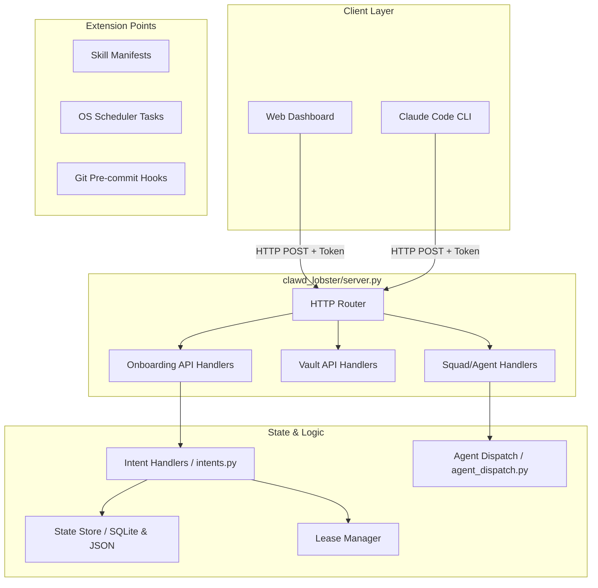

# Architecture, Event Loop, and Handlers Guide

This document provides a deeper dive into the Clawd-Lobster architecture, the asynchronous event loop design, and a guide for authoring custom handlers for both HTTP APIs and state intents.

## 1. Architecture Overview

Clawd-Lobster acts as a nervous system around the Claude Code CLI and the Claude Agent SDK, maintaining state, scheduling, and bridging multiple machines.



### Core Components
* **Thin Server (`server.py`):** Provides a standard-library `HTTPServer` on `127.0.0.1` guarded by a local token. It routes requests to backend APIs.
* **Intent-Based State Transitions (`intents.py`):** A strict single-writer model. Both the web UI and Claude Code propose state changes as intents (e.g., `set_status`, `set_foundation`). All mutations go through `apply_intent()` to ensure transactional safety.
* **Agent Dispatch (`agent_dispatch.py`):** Uses the `claude-agent-sdk` to run sub-agents natively via asynchronous generation without shelling out to the CLI executable.
* **Controller Lease:** Ensures only one client (Web or Claude) mutates state at any given time, preventing race conditions.

---

## 2. Event Loop Lifecycle Design

The Clawd-Lobster system manages long-running agent tasks and HTTP requests. Because `claude-agent-sdk` requires `asyncio` for generating responses, the system must carefully manage event loops, especially when integrating with synchronous HTTP handlers.

### `agent_dispatch.py`

The core function is `async def dispatch(...)`. It manages the asynchronous iteration over `query()` from the Agent SDK.

When calling dispatch logic from synchronous contexts (like the `HTTPServer` handlers in `server.py` or legacy sync CLI scripts), developers must use the `dispatch_sync()` wrapper:

```python
def dispatch_sync(prompt: str, **kwargs: Any) -> DispatchResult:
    try:
        loop = asyncio.get_running_loop()
    except RuntimeError:
        loop = None
    if loop is not None:
        raise RuntimeError(
            "dispatch_sync() cannot be called from a running event loop. "
            "Use 'await dispatch(...)' instead."
        )
    return asyncio.run(dispatch(prompt, **kwargs))
```

### Key Design Principles:
1. **No Nested Loops:** You cannot call `dispatch_sync()` if you are already inside an asynchronous context (like Jupyter or an async web framework like FastAPI/Aiohttp). Doing so raises a `RuntimeError`.
2. **Thread Isolation:** The `HTTPServer` in Python is synchronous and runs handlers in threads (if using `ThreadingHTTPServer`). When a handler needs to trigger an agent via SDK, it calls `dispatch_sync()`, which safely spins up a new localized event loop via `asyncio.run()`, runs the async workflow to completion, and cleans up the loop.
3. **Timeout and Cancellation:** The asynchronous `dispatch` enforces a strict timeout using `asyncio.wait_for`. If the agent runs too long, the task is cleanly cancelled and a timeout message is appended.

---

## 3. Custom Handler Authoring Guide

Clawd-Lobster provides multiple handler extension points.

### A. Authoring an HTTP API Handler (`server.py`)

If you want to add a new backend endpoint (e.g., `/api/system/stats`), you need to extend the router and add a handler method.

**1. Define the Handler Method**
In `clawd_lobster/server.py`, locate the `_Handler` class and add your method prefixed with `_api_`:

```python
    def _api_system_stats(self, query: dict) -> None:
        """Return system statistics.

        Method: GET
        URL: /api/system/stats?verbose=true
        """
        verbose = "verbose" in query and query["verbose"][0] == "true"

        stats = {
            "uptime": get_uptime(),
            "memory": get_memory_usage() if verbose else "N/A"
        }

        self._send_json({"ok": True, "stats": stats})
```

**2. Route the Request**
Map the URL path to your method in `do_GET` or `do_POST`.

```python
    def do_GET(self) -> None:
        # ... validation ...
        routes = {
            "/api/system/stats": self._api_system_stats,
            # ... existing routes ...
        }
        # ...
```

### B. Authoring a State Intent Handler (`intents.py`)

All state mutations in the onboarding/setup process flow through `intents.py`. This acts as a reducer pattern.

**1. Define the Intent Function**
In `clawd_lobster/onboarding/intents.py`, create a handler function. It must accept the state, target item ID, payload, and actor string. It must return a dictionary indicating success or failure.

```python
def _intent_custom_action(
    state: dict, item_id: str | None, payload: dict, actor: str,
) -> dict:
    """Handle a custom action intent."""
    if not item_id:
        return {"ok": False, "error": "item_id required"}

    custom_val = payload.get("value")
    if not custom_val:
        return {"ok": False, "error": "payload.value required"}

    item = state_store.find_item(state, item_id)
    if item is None:
        return {"ok": False, "error": f"Item not found: {item_id}"}

    # Apply mutation
    item["facts"]["custom_key"] = custom_val
    item["last_actor"] = actor

    return {"ok": True, "message": f"{item_id}: custom action applied"}
```

**2. Register the Intent**
Add your function to the `handlers` dictionary inside `apply_intent()`:

```python
    handlers = {
        "set_status": _intent_set_status,
        "set_facts": _intent_set_facts,
        "custom_action": _intent_custom_action, # <--- Added here
        # ...
    }
```

By following this pattern, the system will automatically log the event to `events.jsonl`, increment the state revision, and broadcast the change safely without race conditions.
